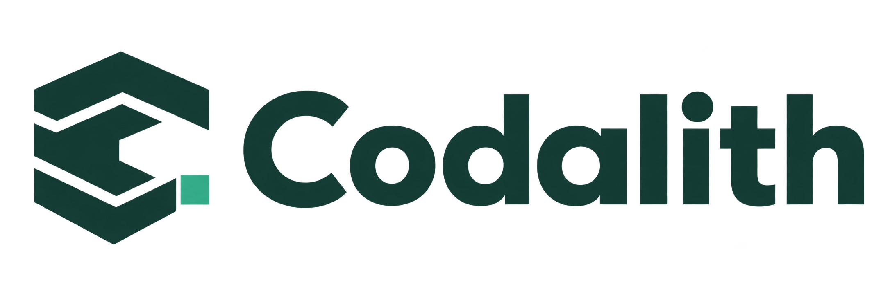

<p align="center">
  <picture>
    <source media="(prefers-color-scheme: dark)" srcset="docs/assets/brand/codalith-logo-dark.png">
    
  </picture>
</p>

# Codalith

[English](README.md) · **简体中文**

**为 AI 编程 Agent 提供带版本的源码证据。**

Codalith 是一个本地优先的 MCP 服务，帮助 Agent 查找实现、定位符号、追踪引用并比较源码版本。它将不可变的 SQLite 结构索引与混合语义检索结合，返回有界源码文本，同时提供行号引用、revision、generation，以及当前文件和索引时的 SHA-256 哈希。

[快速开始](#-快速开始) · [MCP 工具](#mcp-工具) · [文档导航](#文档导航) · [网站源码](website/README.md)

## ✨ 可以做什么

- **找到具体实现。** 综合符号、文件、语义与字面文本检索，为问题提取有界上下文包。
- **核对源码证据。** 按规范的 `codalith://` 源码 URI 读取，并通过哈希和 stale 状态识别索引后的源码变化。
- **探索代码关系。** 定位定义、有界遍历引用图，并比较已注册语料之间的符号结构。
- **固定源码版本。** 单次调用对每个语料使用同一个不可变 generation；新 generation 验证通过后才原子发布。
- **接入现有 Agent。** stdio 与 Streamable HTTP 提供相同的 8 个只读工具；内置 `codalith-source` skill 指导检索与引用核验。
- **查看服务运行情况。** 可选的 HTTP 运维面板展示 readiness、generation 大小、查询延迟、工具使用与进程遥测。

目前提供 **Python**、**C#** 和 **C++ / Unreal Engine** 结构适配器。**generic** 适配器可索引其他文本，不提供结构化符号提取。

## 从问题到源码证据

针对内置 sample 语料，调用 `codalith_context`：

```json
{
  "query": "How does EventBus dispatch an event?",
  "target": "sample",
  "max_spans": 2,
  "max_chars": 4000
}
```

返回的上下文包含 `EventBus`，位置为 `codalith://sample/source/src/core/events.py#L15-L24`。其中的事件分发实现为：

```python
def dispatch(self, event: Event) -> None:
    for handler in self._handlers.get(event.name, []):
        handler(event)
```

这个示例来自仓库内的 [sample 源码](fixtures/sample_corpus/src/core/events.py)。一次本地 sample 验证返回 revision `sample-v1`，当前哈希与索引哈希一致，且 `stale: false`、`truncated: false`、`degraded: false`。每次构建的 generation ID 都会变化。使用证据前检查这些字段与 `warnings`，引用时保留工具实际返回的完整源码 URI。

## 🚀 快速开始

### 1. 启动本地 sample 服务

先安装 **Python 3.11+**、[uv](https://docs.astral.sh/uv/) 与 Git，然后在终端执行：

```bash
git clone https://github.com/cyber-tao/Codalith.git
cd Codalith
uv sync --frozen
uv run --frozen codalith index build --corpus sample --semantic build
uv run --frozen codalith doctor --target sample --deep
uv run --frozen codalith serve --transport http
```

sample 使用确定性的 **fake embeddings**，无需 API key，也不下载 embedding 模型。它用于演示索引和 Agent 集成流程，不能用作语义检索质量评测。

构建应报告 **2 个文件、8 个符号**；doctor 应报告 `"ready": true` 与 `"failures": []`。保持服务终端运行。默认 MCP 地址为 `http://127.0.0.1:8765/mcp`；默认 target 就绪后，[readiness](http://127.0.0.1:8765/readyz) 返回 HTTP 200。

### 2. 连接 Agent

在仓库目录打开另一个终端，运行对应平台的安装器：

```powershell
# Windows
powershell -NoProfile -ExecutionPolicy Bypass -File .\install.ps1
```

```bash
# macOS / Linux
sh ./install.sh
```

安装器检测支持的 Agent，验证 MCP 连通性与 readiness，安装 `codalith-source`，并合并 `codalith` MCP 配置。修改前会备份已有配置文件。重启所选 Agent 或重新加载其 MCP 配置后，可以提问：

> 使用 Codalith 的 sample 语料解释 EventBus 如何分发事件，并引用源码。

支持的集成包括 **Codex、Claude Code、Cursor、Windsurf、VS Code Copilot、Gemini CLI 和 OpenCode v1**。用 `--agent codex --agent claude` 指定客户端，或用 `--dry-run` 预览改动。仍需遵循 Agent 自身的项目可信与 MCP 授权提示。项目级安装、远程环境、备份和 `--check` 见 [安装文档](docs/installation.md)。

如果只需输出配置而不写入客户端文件：

```bash
uv run --frozen codalith client-config --client codex --transport http
uv run --frozen codalith client-config --client claude --transport stdio
```

### 可选：Docker 与运维面板

安装 Docker Compose 后，以下命令会构建镜像、索引 sample 并启动 HTTP 服务：

```bash
docker compose up --build mcp-http
```

打开 [运维面板](http://127.0.0.1:8765/dashboard/)。如果希望同时启动 sample 服务并安装 Agent 集成，可改为给平台安装器加上 `--start-service sample`。同一时间只让一个服务占用 8765 端口。

源码运行时，需要在启动 HTTP 服务前单独构建面板：

```bash
bun install --cwd dashboard --frozen-lockfile
bun run --cwd dashboard build
```

健康检查、面板行为与 UE 配置见 [运维文档](docs/operations.md)。

## MCP 工具

| 工具 | 用途 |
| --- | --- |
| `codalith_search` | 通过 `auto`、`semantic`、`text` 或 `symbol` 策略发现源码 |
| `codalith_context` | 获取有界、无重叠的源码上下文包 |
| `codalith_read` | 读取索引中的规范源码 URI，返回哈希与 stale 状态 |
| `codalith_symbol` | 精确或模糊解析符号定义 |
| `codalith_graph` | 有界遍历入边或出边引用证据 |
| `codalith_compare` | 比较两个语料的结构符号 |
| `codalith_catalog` | 发现已注册源码版本、精确 revision、readiness 与检索能力 |
| `codalith_status` | 不加载 embedding 模型、不扫描源码，检查 readiness 与 provenance |

工具输入拒绝未知字段；两种传输均使用官方 MCP Python SDK。源码策略的 deny 规则过滤工具输出，源码读取使用配置的行数与字节预算。完整输入、返回字段、限制与错误说明见 [MCP API](docs/mcp-api.md)。

## 接入自己的源码

在 [configs/registry.toml](configs/registry.toml) 中配置语料，在 [configs/source-policy.toml](configs/source-policy.toml) 中配置读取预算与 deny 模式。相对路径以声明它的 TOML 文件为基准。每个语料记录源码根目录、revision、索引根目录、adapter、文件选择规则和 embedding provider。

| 设置 | 选择与行为 |
| --- | --- |
| 结构适配器 | `python`、`csharp`、`cpp-ue`、`generic` |
| Embedding | `fake` 用于确定性测试，`fastembed` 用于本地模型，`openai` 用于 OpenAI 兼容接口 |
| `--semantic build` | 按该快照的索引文件，在新 generation 内构建全新的语义 store |
| `--semantic adopt` | 核验模型、维度与源码内容后复用已有 store，记录覆盖率并固定 store 路径 |
| `--semantic none` | 构建结构 generation，无法使用语义检索，也不满足完整 readiness |

语义查询时也需要对应的 embedding provider；字面 `text` 与 `symbol` 检索不依赖语义平面。本地优先部署可使用本地 embedding 模型；配置外部接口时，embedding 输入会发送给该 provider。

sample 的默认索引位于 `data/indexes/sample`；Compose 使用 `codalith-data` 卷持久化。源码选择规则、adapter 版本、语义引擎版本及配置都属于 generation 有效性条件，相关变更后需要重建或重新 adopt。详见 [配置](docs/configuration.md)、[架构](docs/architecture.md) 与 [UE 运维](docs/operations.md#ue-574)。

## 项目状态与边界

- **开发阶段：** 持久化格式和配置可能变化，升级时按 [迁移说明](docs/operations.md#migration-notes) 处理。
- **部署：** HTTP 默认发布到 loopback，检查 Host/Origin 并限制请求体。管理员 bearer 认证保护管理路由；MCP、catalog 和监控路由没有内置网络认证或多租户访问控制。远程访问仍需置于可信且带认证的边界之后。
- **证据：** 引用图描述静态证据，不能证明运行中进程的回调注册情况或执行顺序。
- **运维：** 面板遥测有容量上限，仅保存在当前进程内，重启后清空，不是持久审计日志。

## 文档导航

| 文档 | 内容 |
| --- | --- |
| [安装](docs/installation.md) | Agent 接入、支持的客户端、作用域、验证与恢复 |
| [配置](docs/configuration.md) | 语料注册表、源码策略、路径与环境变量 |
| [MCP API](docs/mcp-api.md) | 工具、源码引用、schema 与错误契约 |
| [架构](docs/architecture.md) | 模块边界、不可变 generation 与不变量 |
| [运维](docs/operations.md) | 本地/Compose 服务、面板、UE 与迁移 |
| [评测](docs/evaluation.md) | 真实 MCP benchmark、独立数据集与验收门槛 |
| [网站源码](website/README.md) | 构建与预览双语项目网站 |

## 开发与反馈

安装开发依赖后运行 Python 检查：

```bash
uv sync --frozen --extra dev
uv run --frozen pytest -q
uv run --frozen ruff check src tests
uv run --frozen mypy src
uv run --frozen python scripts/check_distribution.py
```

修改运维面板时：

```bash
bun install --cwd dashboard --frozen-lockfile
bun run --cwd dashboard typecheck
bun run --cwd dashboard test
bun run --cwd dashboard build
```

对运行中的 sample 服务执行 HTTP 集成验证：

```bash
uv run --frozen codalith benchmark --dataset benchmarks/datasets/sample-smoke.jsonl --endpoint-url http://127.0.0.1:8765/mcp --label local-sample
```

通过 [GitHub Issues](https://github.com/cyber-tao/Codalith/issues) 提交可复现的问题，附上命令、语料 revision、generation ID、相关 warnings 和最小复现，省略无权分享的源码与全部凭证。

## 许可证与致谢

仓库目前没有声明整个项目许可条款的根目录许可证。语义引擎附带自己的 [Apache-2.0 许可证](src/codalith/semantic/LICENSE) 与 [CodeRAG 来源声明](src/codalith/semantic/NOTICE)，这些组件声明不等于整个仓库使用同一许可证。被索引的源码仍受其原始许可证及访问条款约束。
